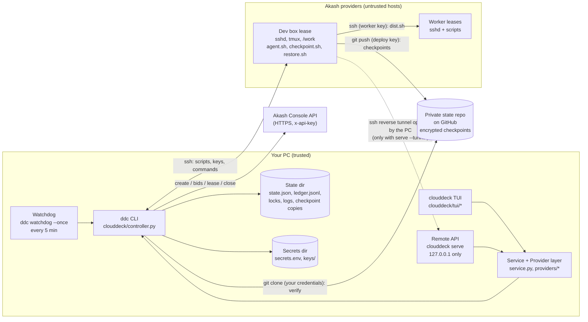
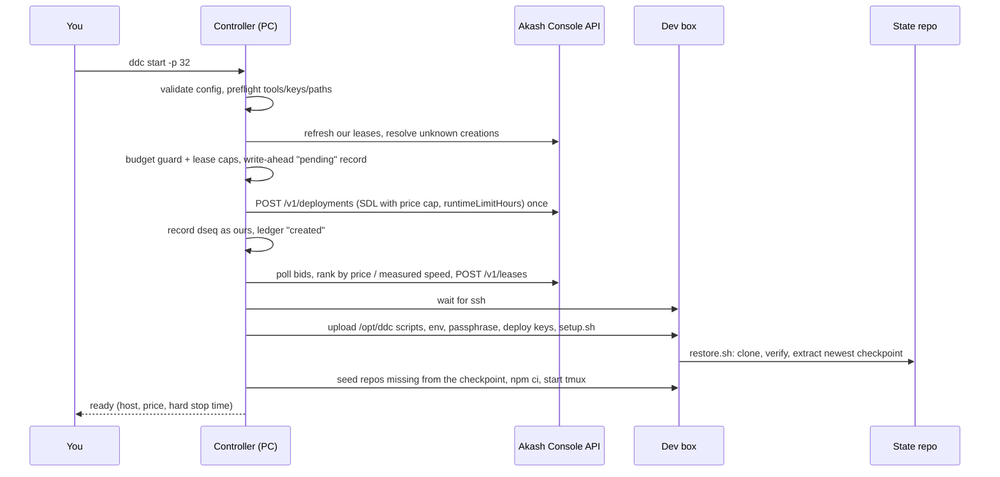
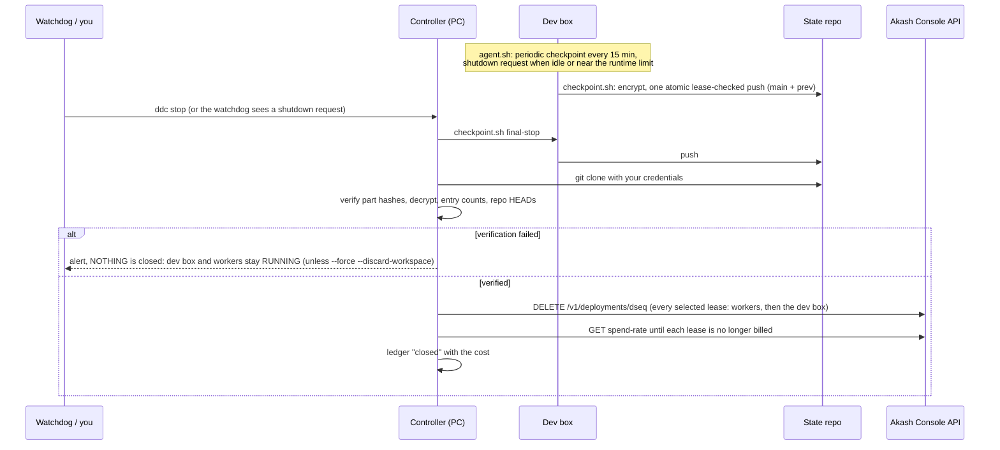

# Architecture

CloudDeck has one rule that shapes everything: **the controller, the Akash API key and the signing path stay on your PC; every rented
box is untrusted.** The PC creates leases, pushes just enough to a box to make it useful, and takes everything back out through
verified checkpoints. A box can ask for things (a shutdown request, a checkpoint) but can close nothing and holds no Akash credential.

## Components



| Piece | File(s) | Role |
|---|---|---|
| **Controller** (`ddc`) | `clouddeck/controller.py` | the only code that creates or closes leases: config validation, budget guard, Akash API calls, SDL rendering, bid ranking, SSH, seeding, checkpoint verification, watchdog pass, installers |
| **CLI** (`clouddeck`) | `clouddeck/cli.py` | `tui`, `status`, `doctor`, `install`, `serve`, `remote`, `providers` |
| **TUI** | `clouddeck/tui/*` | Textual app: five tabs, dialogs with typed confirmations, background polling |
| **Service** | `clouddeck/service.py` | provider-independent: live probes of boxes, projects and environments (config edits), Claude Code sessions in tmux, dispatching commands to workers |
| **Providers** | `clouddeck/providers/*` | the `Provider` contract (`base.py`), `akash.py` (an adapter over the controller), `demo.py` (simulated; what the tests and `-p demo` use) |
| **Remote API** | `clouddeck/remote.py`, `remote_client.py` | loopback HTTP API for a terminal on the dev box, and its stdlib-only client |
| **Lease scripts** | `lease/*.sh` | uploaded to `/opt/ddc` on every lease; run on the lease, never on your PC |
| **Job runner** (`ddc job`) | `clouddeck/job/*` | batch workloads on one short-lived lease with role `job`: preflight, bid early / lease late, steps, verified retrieval. It creates leases only through `launch_lease` and closes only through `close_box`; see [JOBS.md](JOBS.md) |
| **Job scripts** | `jobremote/*.sh` | `boot.sh` is inlined into a job's SDL, `step.sh` and `fetch.sh` are uploaded to `/work/.ddc`; shipped in the wheel under `clouddeck/data/jobremote` |
| **SDL template** | `sdl.yaml.tmpl` | the Akash order; rendered from validated config values only; contains public keys only |

`clouddeck/engine.py` imports the controller as a library, so `ddc` and `clouddeck` always agree on config, limits and state.

## Data flow: `ddc start`



Safety properties of this path:

* The create request is sent **once**. A timeout or server error is "outcome unknown": the deployment is looked up by its unique name
  (`ddc-dev-32-<MMDDhhmm>-<nonce>`) and either adopted or left as a recorded pending creation counted in the budget. Never retried blindly.
* The limit check and the write-ahead record happen under one lock, so concurrent callers (CLI, TUI, remote API) cannot both pass the
  same budget.
* Any failure after the create request closes the lease this call created (and only that one); if that close fails too, the error
  says the lease may still be billing.
* All callers (start, scale, heal, TUI deploy and resize, remote scale) go through one function, `create_box`, which calls the guard itself.

## Data flow: `ddc job run`

1. Preflight (read-only): the spec, the SDL for each image, hardware limits, inputs, secrets present locally, and the controller's own
   `check_spend` (balance, lease caps, ceilings, budget guard). The spec's caps are clamped to the config.
2. `launch_lease` (under the cross-process lock): `check_spend` again, a write-ahead `pending` record, one `POST /v1/deployments` with
   `runtimeLimitHours`, promotion to a state record (`ours`, role `job`, name `ddc-job-...`). An unknown outcome is looked up by name, never
   repeated.
3. Bids are ranked (expected cost, provider history, never above the user's cap); the lease request handles an unknown outcome by looking at
   the deployment, never by posting again; the provider's ssh host and port are validated; the record gets `heartbeat_at` and `deadline_at`.
4. The runner talks to the box over short ssh calls (`ddc.ssh_args`), uploads inputs, starts steps and downloads, pulls and verifies
   artifacts, and writes a heartbeat about once a minute.
5. `close_box` closes the lease (also in `finally`, signal handlers and `atexit`). If the runner dies instead, the watchdog's orphan rule
   closes the lease once the heartbeat has been silent for `job_orphan_minutes`.

## Data flow: checkpoint and stop



Details of the checkpoint format and failure modes: [CHECKPOINTS.md](CHECKPOINTS.md).

## Data flow: the watchdog pass

`ddc watchdog --once` (scheduled every 5 minutes) takes the controller lock (a start or stop in progress makes it skip and try next
time), refreshes lease states from the API, resolves unknown creations, then in order: budget stop, 80% alert, close leases that never
became ready (30 min), read the dev box agent's `/run/ddc/state.json` over SSH (connection failures for 30 min: close; a local ssh problem
only alerts), flag a dead agent or failing checkpoints, close the dev box on an idle/runtime request through a normal verified stop,
close idle workers. Right after the refresh it closes orphaned job leases (heartbeat silent for `job_orphan_minutes`, or past their own
deadline), and the budget stop closes job leases too. Every failure
is logged and alerted; after 3 in a row it attempts a safe stop. Full behaviour: [COSTS-AND-SAFETY.md](COSTS-AND-SAFETY.md#the-watchdog-and-what-happens-when-it-does-not-run).

## Ownership model

A lease is **ours** only if all of these hold, checked again immediately before every close (`assert_ours`):

1. `state.json` has a record for its `dseq` with `"ours": true` (written only when this program created the deployment, or by
   `ddc reconcile --adopt`);
2. its recorded name and its Akash Console name both start with `ddc-`;
3. when the API reports an owner address, it matches the account our other leases belong to.

Everything else on the Akash account (other apps you run there) is listed read-only as *external* and cannot be closed, resized or
adopted from the TUI. A plain `ddc stop` closes the dev box, the workers and the owned `job` leases (the user's kill switch); any other role (generic instances) is only closed when named
with `--only`, and `--workers-only`, `--only` and the watchdog's stops do not include job leases. A damaged state file never reads as "no leases": it blocks new leases until `ddc reconcile` resolves it. Records created by
`ddc reconcile --adopt` are marked `adopted`; the watchdog and `ddc start` never close those on their own, only you naming them does.

One deliberate exception to rule 1: when `state.json` is damaged, `ddc stop` (and the watchdog's safe stop) build their list from a
read-only listing of the account instead: only deployments named `ddc-*` whose owner matches the owner recorded in `state.json.bak` (or,
without a backup, the single owner of all of them) are considered. A dev lease found this way whose ssh endpoint cannot be read has
no workspace that can be checkpointed, so closing it needs `--discard-workspace`.

## State files

All under the state directory ([PLATFORMS.md](PLATFORMS.md#where-files-live)). JSON is written atomically (temp file, fsync, replace);
`state.json` and the ledger use an OS file lock (`state.lock`) that the OS releases when a process dies.

| File | Contents |
|---|---|
| `state.json` | lease records and flags (format below); `state.json.bak` is the previous good copy |
| `ledger.jsonl` | append-only spend history, one JSON object per line: `at` (UTC), `event` (`created`, `leased`, `closed`), `dseq`, and for `closed`: `cost_usd`, `transferred_usd`, optional `by` (`platform`, `expired`) |
| `custom_profiles.json` | hardware profiles created in the TUI (same keys as `[profiles.N]`, names like `x8-32-100-g1rtx4090`) |
| `perf.json` | per provider: measured `single_score`, `multi_per_cpu`, `cpu_model`, `measured_at`, `bad_until` (providers that failed provisioning are skipped for 24 h) |
| `bench.jsonl` | one line per box per `ddc bench` run |
| `watchdog.json` | consecutive failures, last result, alert throttling |
| `alerts.jsonl`, `ddc.log` | alerts and the log (never secrets) |
| `known_hosts` | SSH host keys of leases (trust on first use) |
| `jobs/` | `ddc job`: one resume record per job name (`NAME.json`), one run lock per job name (`NAME.lock`) and one SSH known-hosts file per lease (`NAME-<dseq>.known_hosts`, removed when the lease is closed) |
| `telemetry/`, `provider_history.json` | `ddc job`: per-run phase timings (`NAME-<epoch>.json`) and the measured boot time per (provider, image) |
| `checkpoints/` | the last three verified checkpoint copies (encrypted); `verify/` is a scratch clone |
| `ddc.flock`, `state.lock` | cross-process locks (OS locks; a `ddc.lock` file is the pre-release tool's lock, which `ddc` waits for while it is under 3 h old) |
| `clouddeck-tokens.json`, `remote-audit.log` | remote API tokens (hashes only, mode 0600) and request log |
| `clouddeck.json` | TUI preferences (theme) |
| `state.corrupt`, `state.json.corrupt-<time>`, `state.json.replaced-<time>`, `ledger.jsonl.torn-<time>` | what is left after damage was detected: nothing is deleted |

`state.json`:

```json
{
  "deps": {
    "123456789": {
      "ours": true, "name": "ddc-dev-32-10171230-ab12", "role": "dev", "idx": 0, "profile": "32",
      "status": "ready",
      "created_at": 1760000000.0, "lease_at": 1760000100.0, "limit_h": 8, "max_usd_hr": 0.9, "usd_hr": 0.31,
      "provider": "<provider address>", "provider_host": "provider.example.net", "host": "203.0.113.7", "port": 31234,
      "owner": "<account address>", "transferred_usd": 0.12
    }
  },
  "pending": {"ddc-w02-32-10171231-cd34": {"role": "worker", "profile": "32", "idx": 2, "limit_h": 4, "max_usd_hr": 0.9, "created_at": 1760000200.0}},
  "idle_hold_until": 0, "alerted_80": false, "dev_unreachable_since": null
}
```

`status` moves `created` -> `leased` -> `ready` -> `closed`. `role` is `dev`, `worker` (with `idx`, shown as `w01`...), `box` (generic instance) or
`job` (a `ddc job` lease: extra optional keys `job`, `image`, `heartbeat_at`, `deadline_at`; the watchdog's orphan rule reads the last two).
Records of closed leases stay, so the history survives. The format is frozen for compatibility.

## On the lease

Everything is uploaded to `/opt/ddc`; see [`lease/README.md`](../lease/README.md) for the contract (paths, markers, environment variables).

* **Dev box:** `sshd`, tmux session `main` with windows `claude`, `workers`, `shell`; `/work/<project>` per repo; `agent.sh` (activity
  tracker, periodic checkpoints, shutdown *requests*); `checkpoint.sh`, `restore.sh`; `dist.sh` and `workers.sh` for the fleet.
  Configuration arrives in `~/.config/ddc/` (mode 0700/0600).
* **Worker:** `sshd` and the scripts, plus whatever `dist.sh sync` copies from the dev box. Workers receive public keys only.
* **Job box** (`ddc job`): `sshd` started by `jobremote/boot.sh` (root, key-only, host keys generated per container), `/work/.ddc` with `step.sh`,
  `fetch.sh`, marker files and, if the spec lists secrets, a mode-600 `secrets.env`. No ddc lease scripts, no checkpoints.
* The box image is whatever `image` in `config.toml` names (default `node:22-bookworm`); the SDL boot script installs a few packages with
  `apt` as root, then runs `sshd`.

## Configuration resolution

`--config PATH` or `DDC_CONFIG`, else `config.toml` in the user config directory; keys you leave out fall back to the packaged
`config.example.toml` (safe defaults). Profiles from the TUI are merged in from `custom_profiles.json`. The config is validated
before anything is created; a broken config blocks spending commands and `clouddeck doctor` shows why.

## Extension points

**A new cloud: implement `Provider`** (`clouddeck/providers/base.py`). Five methods are required:

```python
from clouddeck.providers.base import Provider, Instance, Offer, Quote, Spec

class MyCloud(Provider):
    id, label = "mycloud", "My Cloud"
    capabilities = frozenset({"ssh", "spend"})           # gpu fleet ssh spend workspace checkpoint heal resize snooze
    def offers(self) -> list[Offer]: ...                 # catalogue rows (hosts, regions, prices)
    def quote(self, spec: Spec) -> Quote: ...            # expected price and a suggested cap
    def instances(self, refresh=False): ...              # refresh=False must be fast (local state only)
    def deploy(self, spec: Spec, log=print) -> Instance: ...
    def terminate(self, instance_id, log=print, *, discard_workspace=False) -> float: ...   # returns the cost
```

* Everything else has a working default or is gated by `capabilities`: `ssh_command()`/`run()` unlock live probes, dispatch, Claude
  sessions and logs; `scale()`, `resize()` and `stop_all()` are built on `deploy`/`terminate`; `checkpoint`/`verify`/`heal`/`idle_state`
  are optional.
* **Spending limits are part of the contract.** Every deploy, scale and resize calls `Provider.require(spec, n)`, which calls
  `Provider.guard()` and raises when it says no. The default `guard()` only validates the spec; a provider that spends money should
  override it with its own limits (`providers/base.judge` is a pure helper for the arithmetic). A refused resize must leave the old
  instance alone.
* Register in-process with `providers.register(MyCloud)`, or ship a package with an entry point:

```toml
[project.entry-points."clouddeck.providers"]
mycloud = "mycloud_pkg:MyCloud"
```

  `clouddeck providers` lists what is found, `clouddeck -p mycloud` uses it. `providers/demo.py` is the smallest complete example and
  what the tests drive. A broken plugin is skipped, never fatal.

**Without code:** `[[workloads]]` (commands for the Workers tab's Dispatch), `[environments.NAME]` (named hardware presets for projects),
`worker_prep_command`, `busy_regex`, `bench_cmd`, `alert_command` and `sync_excludes` in `config.toml` ([CLOUDDECK.md](CLOUDDECK.md)).

## Compatibility promises

These are frozen so existing installations keep working across releases: the `ddc-` lease name prefix and the `ours` semantics in
`state.json`, the `state.json` / `ledger.jsonl` / `custom_profiles.json` formats, the checkpoint layout (branches, archive and part
names, manifest schema, gpg AES256), the lease-side paths and markers (`/opt/ddc`, `/work`, `~/.config/ddc`, `/run/ddc`, tmux
session `main`), and the environment variable names (`DDC_*`, `AKASH_API_KEY`, `CLOUDDECK_*`).
